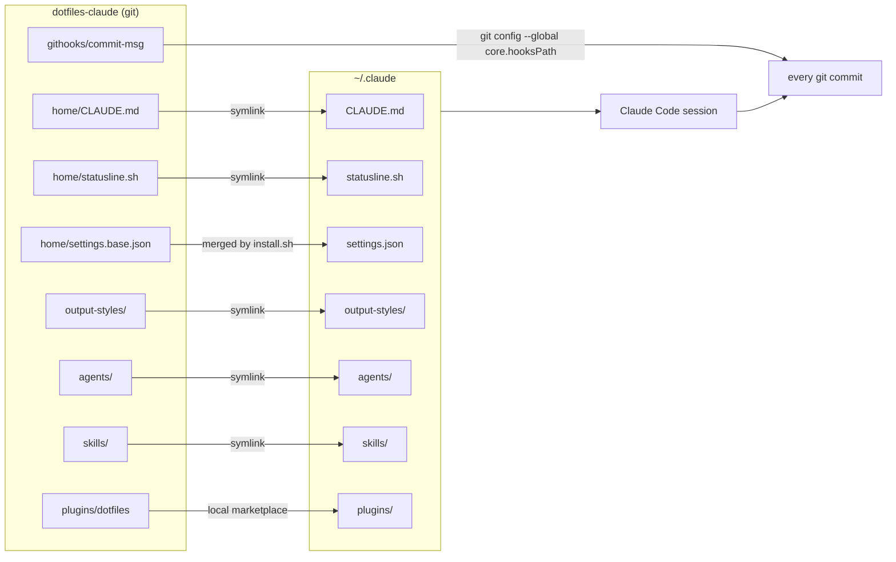

# dotfiles-claude

My [Claude Code](https://claude.com/claude-code) configuration, versioned:
global instructions, an output style, subagents, skills, a plugin with language
servers and a format hook, permission rules, a status line, a git hook, and an
engagement template. This repo is the source of truth; `~/.claude` points here.

## How it reaches a session



Editing a linked file changes the next session. No copy step, no reinstall.
`settings.json` stays a real file because it also holds machine- and
client-specific state, such as the `autoMode` entries `/auto-mode-setup`
writes, so `install.sh` merges the fragment into it. Lists are unioned, so an
entry removed from the fragment must also be removed from `settings.json` by
hand. Scalars set by the fragment are overwritten on every run; keys it does
not set are left alone. Plugin edits apply after `/reload-plugins`.

## Contents

| Path | What |
|---|---|
| `home/CLAUDE.md` | Global instructions: code, Angular commits, docs, tone, tools, delegation |
| `output-styles/pro.md` | `Pro` output style: result first, no filler, evidence for "done" |
| `home/settings.base.json` | Attribution off, output style, status line, plugins |
| `home/statusline.sh` | Model · effort · context bar │ branch │ MR │ VPN tunnel │ LM Studio model when one is loaded │ CPU, RAM and GPU gauges, green/yellow/red by load │ gcloud configuration │ kube context, red on prod |
| `agents/` | 5 subagents: IaC, Kubernetes/GitOps, code review, incidents, AI platform |
| `skills/` | `commit`, `learn`, `humanizer`, `doc-writer`, `reverse-engineer-anything` (third-party, for the REA MCP server) |
| `plugins/dotfiles` | `terraform-ls` and `yaml-language-server`, format-on-edit hook |
| `bin/kube-sync` | One kubeconfig per client from `~/.config/kube/clusters.d/`, short context names, prod read-only in k9s |
| `home/kube.zsh` | `kx`: pick a kube context for one shell, inside the client direnv selected |
| `home/starship.toml`, `home/k9s/skins/` | Prompt with gcloud configuration and kube context, red on prod; red k9s frame on prod |
| `githooks/commit-msg` | Strips AI co-author trailers, checks `Assisted-by:`, enforces the Angular header |
| `templates/AGENTS.md.template` | Engagement instructions to copy into a client repo |
| `templates/settings.json.template` | Per-repo `Stop` hook that blocks "done" until the check passes |
| `install.sh` | Idempotent deployment and drift check |
| `docs/routine.md` | Day-to-day habits with this setup: sessions, clusters, "done", merge requests, weekly upkeep |

## Standalone, or imported by a team configuration

`install.sh` has two modes and picks one by itself:

| Mode | When | Installs |
|---|---|---|
| Standalone | default | everything in this repo, as described above |
| Personal layer | `~/.claude/CLAUDE.md` was generated by a team configuration (agent-config) | `home/CLAUDE.personal.md`, the output style, the status line, the prompt, the skills the team does not ship, and the `outputStyle` and `statusLine` settings |

The team configuration imports this repo at a release tag: the generic
tooling (`kube-sync`, `kx`, the k9s skin, the commit hook, the LSP and format
plugin, the `commit`, `doc-writer` and `humanizer` skills, the engineering
subagents) lives only here, and the team pins a version of it instead of
copying it. Each file therefore exists once. The team configuration owns its
own rules, methods and permission rules.

In the layered mode every path has one owner: the team setup generates
`CLAUDE.md` (which imports `CLAUDE.personal.md`), links skills and agents one
by one, and sets permissions, attribution, plugins and hooks. This script adds
its items next to them and leaves anything the team set up alone, so a skill
both provide resolves to the team's pinned copy.

## Install

Requires macOS, Linux or WSL2 (under `~`, never `/mnt/c`), `git`, `python3`,
`jq`, `claude`, and an SSH `private` host alias.

```sh
git clone git@private:mjebalidev/dotfiles-claude.git ~/Private/dotfiles-claude
cd ~/Private/dotfiles-claude
./install.sh
./install.sh --check
```

| Flag | Effect |
|---|---|
| *(none)* | Links, merges settings, installs the plugins, sets `core.hooksPath` |
| `--check` | Reports every difference between the repo and `~/.claude`, changes nothing, exits 1 on drift |
| `--no-git-hooks` | Leaves `core.hooksPath` alone |

Links are rebuilt from the checkout's current path, so re-running after moving
the repo or changing machine repairs them. Anything in the way is moved to
`*.bak.<n>`; nothing is deleted.

Tools the config expects on `PATH` (Homebrew names):

```sh
brew install jq yq fzf bash direnv k9s starship terraform-ls yaml-language-server pyright ast-grep difftastic kubeconform
```

## Guardrails

The format hook runs `tofu fmt` and `terragrunt hcl fmt` after every edit, and
`ruff` and `prettier` only where the project configures them. Permission rules
(what to deny, what to confirm first) are a team policy: they live in the
team configuration this repo is installed under, not here.

## The commit hook

`core.hooksPath` is global, so the hook would otherwise hide each repo's own
`.git/hooks/commit-msg`. It runs that local hook first and honours its exit
code. Repos that set `core.hooksPath` themselves, which is what Husky does,
override the global value and never reach this hook — use `commitlint` with
`@commitlint/config-angular` there instead.

The hook removes `Co-Authored-By: Claude`, `Generated with … Claude` and
`Claude-Session:` lines. Agent help is declared with one
`Assisted-by: <tool>:<model>` trailer instead, which the hook rejects if
malformed. It then checks the subject against:

```
^(build|chore|ci|docs|feat|fix|perf|refactor|test|revert)(\([a-z0-9._/-]+\))?!?: [^A-Z].{0,70}[^.]$
```

`Merge`, `Revert "`, `fixup!` and `squash!` subjects are exempt.

## SSH `private` host alias

The remote uses the `private` alias so `~/.ssh/config` decides which key and
account are used.

```
Host private
  HostName github.com
  User git
  IdentityFile ~/.ssh/private
  IdentitiesOnly yes
```

## What is not here

Nothing from `~/.claude` that is sensitive or machine-local: credentials,
`projects/`, `history.jsonl`, `sessions/`, the `autoMode` entries specific to a
client, and skills synced from claude.ai (`skills/synced/`, ignored).
