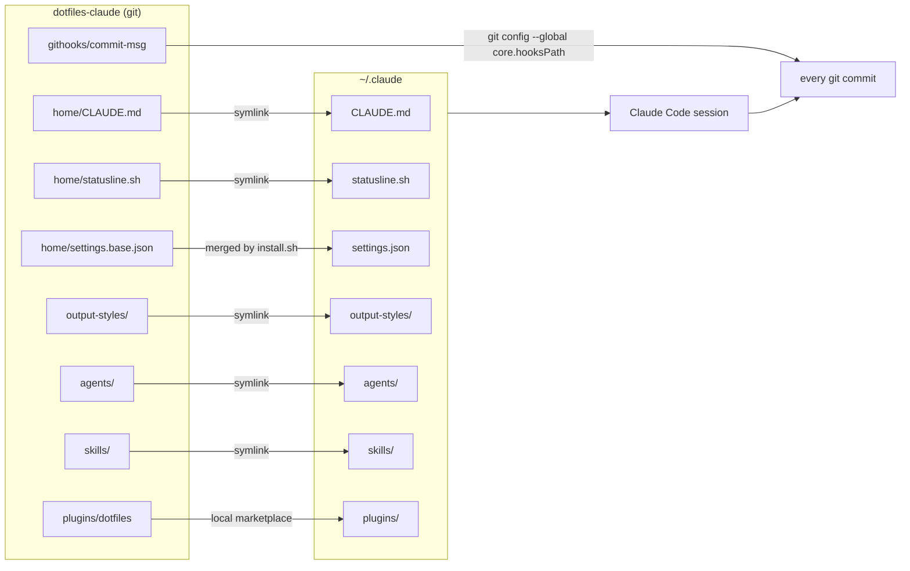

# dotfiles-claude

My [Claude Code](https://claude.com/claude-code) configuration, versioned:
global instructions, an output style, subagents, skills, a plugin with language
servers and a format hook, permission rules, a status line, a git hook, and an
engagement template. This repo is the source of truth; `~/.claude` points here.

## How it reaches a session



Editing a linked file changes the next session. No copy step, no reinstall.
`settings.json` stays a real file because it also holds machine- and
client-specific state, such as the `autoMode` entries `/auto-mode-setup`
writes, so `install.sh` merges the fragment into it. Lists are unioned, so an
entry removed from the fragment must also be removed from `settings.json` by
hand. Scalars set by the fragment are overwritten on every run; keys it does
not set are left alone. Plugin edits apply after `/reload-plugins`.

## Contents

| Path | What |
|---|---|
| `home/CLAUDE.md` | Global instructions: code, Angular commits, docs, tone, tools, delegation |
| `output-styles/pro.md` | `Pro` output style: result first, no filler, evidence for "done" |
| `home/settings.base.json` | Attribution off, output style, status line, plugins, permission rules, auto mode environment |
| `home/statusline.sh` | Model · effort · context │ branch │ MR │ gcloud project │ kube context |
| `agents/` | 7 subagents: IaC, Kubernetes/GitOps, code review, incidents, SRE audit, AI platform, pre-sales |
| `skills/` | `commit`, `humanizer`, `doc-writer`, `sre-audit`, `presales-deliverables`, `reverse-engineer-anything` (third-party, for the REA MCP server) |
| `plugins/dotfiles` | `terraform-ls` and `yaml-language-server`, format-on-edit hook, end-of-session learnings capture into `~/.claude/learnings/inbox/` |
| `githooks/commit-msg` | Strips AI trailers, then enforces the Angular header |
| `templates/AGENTS.md.template` | Engagement instructions to copy into a client repo |
| `templates/settings.json.template` | Per-repo `Stop` hook that blocks "done" until the check passes |
| `install.sh` | Idempotent deployment and drift check |

## Install

Requires macOS, Linux or WSL2 (under `~`, never `/mnt/c`), `git`, `python3`,
`jq`, `claude`, and an SSH `private` host alias.

```sh
git clone git@private:mjebalidev/dotfiles-claude.git ~/Private/dotfiles-claude
cd ~/Private/dotfiles-claude
./install.sh
./install.sh --check
```

| Flag | Effect |
|---|---|
| *(none)* | Links, merges settings, installs the plugins, sets `core.hooksPath` |
| `--check` | Reports every difference between the repo and `~/.claude`, changes nothing, exits 1 on drift |
| `--no-git-hooks` | Leaves `core.hooksPath` alone |

Links are rebuilt from the checkout's current path, so re-running after moving
the repo or changing machine repairs them. Anything in the way is moved to
`*.bak.<n>`; nothing is deleted.

Tools the config expects on `PATH` (Homebrew names):

```sh
brew install jq terraform-ls yaml-language-server pyright ast-grep difftastic kubeconform
```

## Guardrails

Rules that must hold every time live in settings, not in prose:

| Mechanism | Covers |
|---|---|
| `permissions.deny` | Reads of `.env` files (not `.env.example`), Terraform state, SSH keys, gcloud, glab and Vault credentials, anywhere on disk |
| `permissions.ask` | The common mutating forms of `kubectl`, `helm`, `tofu`/`terraform`/`terragrunt`, `gcloud`, `glab`, `flux`, `argocd`, `vault` |
| `autoMode.environment` | `$defaults` plus the shape of the stack, so the classifier keeps its built-in rules |
| Format hook | `tofu fmt` and `terragrunt hcl fmt` always; `ruff` and `prettier` only where the project configures them |

Deny and ask rules hold in every permission mode, auto mode included. They match
command text, so `sh -c '…'` or an absolute binary path slips past them; the
sandbox (`/sandbox`) is the OS-level layer.

## The commit hook

`core.hooksPath` is global, so the hook would otherwise hide each repo's own
`.git/hooks/commit-msg`. It runs that local hook first and honours its exit
code. Repos that set `core.hooksPath` themselves, which is what Husky does,
override the global value and never reach this hook — use `commitlint` with
`@commitlint/config-angular` there instead.

The hook removes `Co-Authored-By: Claude`, `Generated with … Claude` and
`Claude-Session:` lines, then checks the subject against:

```
^(build|chore|ci|docs|feat|fix|perf|refactor|test|revert)(\([a-z0-9._/-]+\))?!?: [^A-Z].{0,70}[^.]$
```

`Merge`, `Revert "`, `fixup!` and `squash!` subjects are exempt.

## SSH `private` host alias

The remote uses the `private` alias so `~/.ssh/config` decides which key and
account are used.

```
Host private
  HostName github.com
  User git
  IdentityFile ~/.ssh/private
  IdentitiesOnly yes
```

## What is not here

Nothing from `~/.claude` that is sensitive or machine-local: credentials,
`projects/`, `history.jsonl`, `sessions/`, the `autoMode` entries specific to a
client, and skills synced from claude.ai (`skills/synced/`, ignored).
